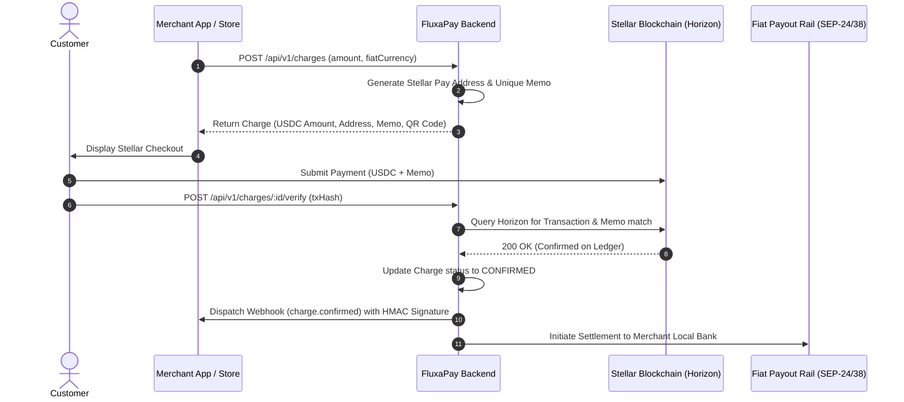

# FluxaPay Backend: Stellar-Powered Crypto-to-Fiat Payment Gateway

[](https://github.com/MetroLogic/fluxapay-backend/actions/workflows/ci.yml)
[](https://nodejs.org/)
[](https://www.typescriptlang.org/)
[](https://www.prisma.io/)
[](https://stellar.org/)
[](LICENSE)

**FluxaPay** bridges the gap between decentralized crypto payments on the **Stellar blockchain** and real-world merchant commerce. It enables merchants across emerging markets and globally to accept **USDC on Stellar** seamlessly—with the developer ergonomics of Stripe—while receiving automated local fiat settlements.

---

## 🌟 Why Stellar & FluxaPay?

Despite widespread stablecoin adoption, everyday merchant commerce remains strictly fiat-denominated. Crypto holders face high off-ramping fees, slippage, and checkout friction every time they pay. 

FluxaPay eliminates this friction by leveraging **Stellar's sub-cent transaction fees and 3-5 second finality**:
- **USDC-in → Fiat-out**: Customers pay directly in USDC on Stellar from any non-custodial wallet (Freighter, LOBSTR, xBull).
- **Zero Merchant Volatility**: Merchants specify prices in USD, NGN, KES, GHS, EUR, or ZAR; FluxaPay calculates on-chain quotes via SEP-0038 and settles in local currency.
- **Developer-First SDK & API**: Drop-in REST endpoints, webhook verification, and payment links.

---

## 🏗 Architecture & Payment Flow



---

## 🚀 Key Features & Standards

### 1. Stellar Ecosystem & SEP Protocols
- **Horizon & Soroban Integration**: Real-time ledger queries, memo matching, and transaction verification via `@stellar/stellar-sdk`.
- **SEP-0038 Compliant FX Quotes**: Real-time conversion quotes between Stellar USDC and fiat currencies (USD, EUR, NGN, KES, GHS, ZAR, BRL) with a 15-minute price lock.
- **Interactive Anchor Architecture (SEP-0024)**: Structured pipeline for fiat on/off-ramp partners and merchant bank disbursements.

### 2. Developer Platform & Hardening
- **Prisma ORM & PostgreSQL**: Scalable data layer featuring models for `Merchant`, `Customer`, `ApiKey`, `Charge`, `Settlement`, `Webhook`, and `Invoice`.
- **Security & Threat Mitigation**:
  - Helmet HTTP security headers
  - Strict CORS policy with dynamic origin whitelist
  - Dual Rate Limiting: IP-based sliding window (`express-rate-limit`) + API key token bucket
  - Bearer JWT authentication for Dashboard + SHA-256 hashed API Keys (`flx_live_...`) for developer APIs
- **Webhooks with Cryptographic Verification**: Signed using HMAC-SHA256 headers (`x-fluxapay-signature`) and logged delivery history with retry states.
- **Enterprise Observability**: Structured Winston logging with correlation IDs (`x-request-id`), Morgan HTTP middleware, and deep `/health` checks.
- **Kubernetes Ready**: Dedicated `/health/liveness` and `/health/readiness` probes.

---

## 📡 API Reference & Quickstart

Base URL: `http://localhost:3000`  
Interactive Swagger Documentation: `http://localhost:3000/api-docs`

### 1. Get Live FX Quote (SEP-0038)
```bash
curl -X GET "http://localhost:3000/api/v1/charges/rates?amount=1650&currency=NGN"
```
**Response (200 OK):**
```json
{
  "success": true,
  "data": {
    "fromCurrency": "NGN",
    "toCurrency": "USDC",
    "rate": 1650,
    "amountIn": 1650,
    "amountOut": 1.0,
    "expiresAt": "2026-10-12T10:00:00.000Z"
  }
}
```

### 2. Merchant Registration & API Key Issuance
```bash
curl -X POST http://localhost:3000/api/v1/merchants/register \
  -H "Content-Type: application/json" \
  -d '{
    "businessName": "Acme Coffee Store",
    "email": "owner@acmecoffee.com",
    "password": "SecurePassword123!",
    "walletAddress": "GBBD47IF6LWK7P7MDEVSCWR7DPUWV3NY3DTQEVFL4NAT4AQH3ZLLFLA5",
    "fiatSettlementCurrency": "USD"
  }'
```

### 3. Create a Stellar Payment Charge
```bash
curl -X POST http://localhost:3000/api/v1/charges \
  -H "Content-Type: application/json" \
  -H "x-api-key: flx_live_your_api_key_here" \
  -d '{
    "amountFiat": 25.00,
    "fiatCurrency": "USD",
    "description": "Invoice #1049 - Web Design Services",
    "customerEmail": "client@example.com"
  }'
```
**Response (201 Created):**
```json
{
  "success": true,
  "data": {
    "id": "e4a2bc1d-89ef-4567-90ab-cdef01234567",
    "amountUsdc": "25.0000000",
    "stellarPayAddress": "GBBD47IF6LWK7P7MDEVSCWR7DPUWV3NY3DTQEVFL4NAT4AQH3ZLLFLA5",
    "stellarMemo": "FLX-M0Z3K-481920",
    "status": "PENDING",
    "paymentInstructions": {
      "network": "Stellar (Public / Testnet)",
      "asset": "USDC",
      "destination": "GBBD47IF6LWK7P7MDEVSCWR7DPUWV3NY3DTQEVFL4NAT4AQH3ZLLFLA5",
      "memoType": "text",
      "memo": "FLX-M0Z3K-481920"
    }
  }
}
```

### 4. Verify Payment on Stellar Ledger
```bash
curl -X POST http://localhost:3000/api/v1/charges/e4a2bc1d-89ef-4567-90ab-cdef01234567/verify \
  -H "Content-Type: application/json" \
  -d '{"txHash": "a1b2c3d4e5f6...your_stellar_transaction_hash"}'
```

---

## 🛠 Local Setup & Running

### Option 1: Quickstart with Docker Compose (Recommended)
```bash
# Clone the repository
git clone https://github.com/MetroLogic/fluxapay-backend.git
cd fluxapay-backend

# Launch PostgreSQL and Backend containers
docker compose up -d
```
The server will be reachable at `http://localhost:3000` with Swagger UI at `http://localhost:3000/api-docs`.

### Option 2: Local Development
```bash
# 1. Install dependencies
npm install

# 2. Configure environment
cp .env.example .env

# 3. Start PostgreSQL container
docker compose up -d postgres

# 4. Generate Prisma client & sync schema
npx prisma generate
npm run db:push

# 5. Seed test data
npm run db:seed

# 6. Start development server
npm run dev
```

---

## 🧪 Testing & Code Quality

```bash
# Run unit & integration tests with Jest
npm test

# Run ESLint validation
npm run lint

# Validate TypeScript type consistency
npx tsc --noEmit
```

---

## 🤝 Contributing

Contributions are welcomed! Check out [CONTRIBUTING.md](CONTRIBUTING.md) for code conventions, conventional commits, and issue workflows.

## 💬 Community

- **Telegram**: [Join the FluxaPay Builders Community](https://t.me/+m23gN14007w0ZmQ0)
